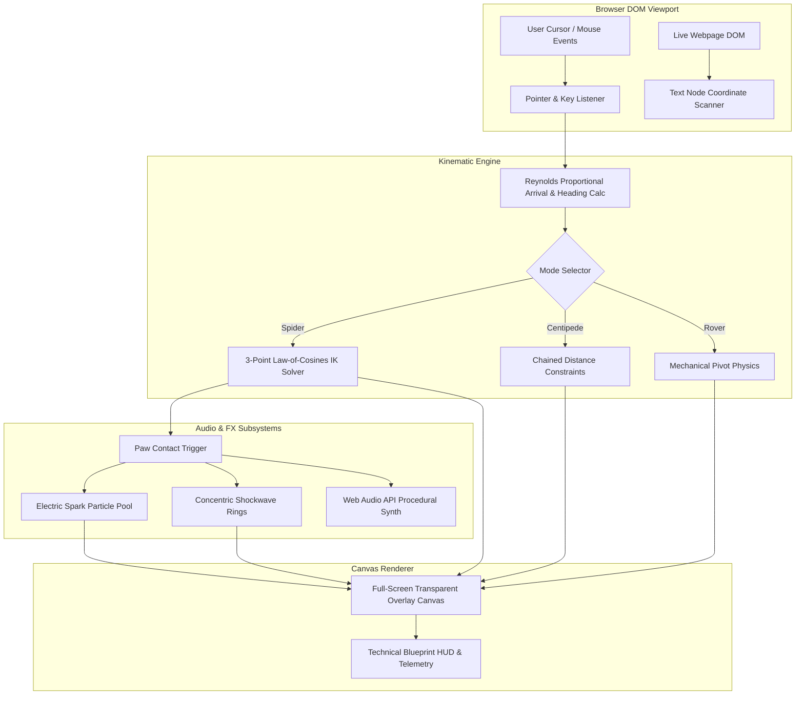

# 🕸️ CRAWLPEDIA // CYBER ENTITIES v5.0
### Autonomous 60 FPS Procedural Inverse Kinematics Engine for Live Webpages

[](https://developer.chrome.com/docs/extensions/mv3/intro/)
[](https://developer.mozilla.org/en-US/docs/Web/JavaScript)
[](https://en.wikipedia.org/wiki/Inverse_kinematics)
[-00f0ff?style=for-the-badge)](https://developer.mozilla.org/en-US/docs/Web/API/Canvas_API)
[](LICENSE)
[](https://github.com/yousufkidiya17/crawlpedia-cyber-entities/pulls)

---

```
   _____ _____         __          ___      _____  ______ _____ _____         
  / ____|  __ \     /\ \ \        / / |    |  __ \|  ____|  __ \_   _|   /\   
 | |    | |__) |   /  \ \ \  /\  / /| |    | |__) | |__  | |  | || |    /  \  
 | |    |  _  /   / /\ \ \ \/  \/ / | |    |  ___/|  __| | |  | || |   / /\ \ 
 | |____| | \ \  / ____ \ \  /\  /  | |____| |    | |____| |__| |_| |_ / ____ \ 
  \_____|_|  \_\/_/    \_\ \/  \/   |______|_|    |______|_____/|_____/_/    \_\
               [ CYBERNETIC WIREFRAME ENTITY RUNTIME // v5.0.0 ]
```

---

## ⚡ Executive Summary

**Crawlpedia Cyber Edition** is a high-performance, autonomous mechanical browser companion engineered with procedural **Inverse Kinematics (IK)**, real-time **Reynolds Arrival Steering**, and dynamic **Web Audio API** procedural sound synthesis. 

Unlike traditional static web overlays or animated GIFs, Crawlpedia injects an isolated, zero-overhead HTML5 Canvas viewport directly over any live webpage (`z-index: 999999`, `pointer-events: none`). The entity dynamically crawls across the DOM, tracks cursor coordinates, anchors catenary laser filaments, and emits electric sparks upon footfall impact—all running at a locked **60 FPS** with zero frame drops or memory leaks.

---

## 🔬 Core Engineering Highlights

### 1. 3-Point Law-of-Cosines Inverse Kinematics (Spider Mode)
Each of the 8 spider limbs is calculated via an analytical 2-segment planar kinematic chain ($l_1 = 30\text{px}$, $l_2 = 36\text{px}$). For any coxa anchor $\mathbf{A}(x_a, y_a)$ and target foot resting vector $\mathbf{F}(x_f, y_f)$:

$$\text{Distance } d = \min\left(\sqrt{(x_f - x_a)^2 + (y_f - y_a)^2},\; l_1 + l_2 - 0.5\right)$$

$$\alpha = \arccos\left(\text{clamp}\left(\frac{l_1^2 + d^2 - l_2^2}{2 \cdot l_1 \cdot d},\; -1,\; 1\right)\right)$$

$$\theta_{\text{knee}} = \operatorname{atan2}(y_f - y_a, x_f - x_a) + \alpha \cdot \text{bendSide}$$

$$\mathbf{K}_{\text{knee}} = \begin{bmatrix} x_a + l_1 \cos(\theta_{\text{knee}}) \\ y_a + l_1 \sin(\theta_{\text{knee}}) \end{bmatrix}$$

This produces anatomically accurate leg bend curvature with zero jitter.

---

### 2. Reynolds Proportional Arrival & Angle-Gated Steering
Traditional pathing produces wide circular drifts when targets appear behind the body. Crawlpedia utilizes a coupled **Angular Velocity Gating** and **Proportional Ramp**:

- **Angle-Gated Throttle**: When angular error $|\Delta\theta| > 35^\circ$ ($0.6\text{ rad}$), the forward surge throttles down to $18\% - 25\%$, while rotational angular speed surges to $20.0\text{ rad/s}$ ($1145^\circ/\text{s}$). The entity pivots crisply on a dime before accelerating forward.
- **Continuous Arrival Curve**:
  $$\text{Ramp}(d) = \operatorname{clamp}\left(\frac{d - r_{\text{stop}}}{r_{\text{slow}} - r_{\text{stop}}},\; 0,\; 1\right) \quad \text{where } r_{\text{stop}} = 24\text{px},\; r_{\text{slow}} = 140\text{px}$$
  $$v_{\text{desired}} = v_{\text{max}} \cdot \text{Ramp}(d) \cdot \max(0.18, \cos(\Delta\theta))$$

This completely eliminates sudden 42px wall halts and provides silky hovering deceleration.

---

### 3. Tactile Particle Physics & Ground Feedback
- **Electric Footstep Sparks**: Every time a leg completes a step cycle ($\text{lift} \le 0$), it triggers micro-bursts of high-velocity spark particles that decay along a quadratic alpha curve.
- **Ground Shockwave Ripples**: Concentric shockwave rings expand at $65\text{px/s}$ with crosshair ticks marking exact coordinates of physical contact.
- **Inter-Leg Laser Filaments**: Quadratic Bezier catenary curves span across adjacent leg pairs with traveling glowing data packets ($t \in [0, 1]$).
- **Surface Draglines**: As the entity traverses the page, it anchors tensile laser silk filaments across DOM scroll space.

---

## 🎮 Morphology Modes & Cyber Palettes

| Mode | Key | Kinematic Engine | Mechanical Behavior |
| :--- | :---: | :--- | :--- |
| **Arachnid (Spider)** | `M` | 8-Legged 3-Point IK Solver | Real-time multi-legged trot gait, catenary laser webs, sensory feelers |
| **Centipede** | `M` | Multi-Segment Chained Invariants | 16 chained vertebrae with tangent-following distance constraints |
| **Rover** | `M` | Mechanical Dual-Axle Chassis | Tank-style skid steering with rigid wheel telemetry |

### Dynamic Neon Themes (`C` Key)
- 🩵 **Cyan Synth**: Primary `#00f0ff` | Neon Glow `rgba(0, 240, 255, 0.4)`
- 💚 **Toxic Lime**: Primary `#00ff66` | Emerald Glow `rgba(0, 255, 102, 0.4)`
- ❤️ **Neon Crimson**: Primary `#ff003c` | Pink-Red Glow `rgba(255, 0, 60, 0.4)`
- 💜 **Electric Violet**: Primary `#b026ff` | Ultraviolet Glow `rgba(176, 38, 255, 0.4)`
- 💛 **Solar Amber**: Primary `#ffb700` | Industrial Hazard Glow `rgba(255, 183, 0, 0.4)`

---

## ⌨️ Interactive Controls & Shortcuts

All hotkeys function seamlessly inside active webpage viewports without interfering with native typing inputs:

| Keybinding | Action | Description |
| :--- | :--- | :--- |
| <kbd>Alt</kbd> + <kbd>Shift</kbd> + <kbd>C</kbd> | **Global Toggle** | Spawn or dismiss the entity across any active tab |
| <kbd>Space</kbd> | **Pause / Resume** | Freeze physics loop in place for inspection |
| <kbd>M</kbd> | **Switch Morphology** | Cycle through Spider $\rightarrow$ Centipede $\rightarrow$ Rover |
| <kbd>C</kbd> | **Cycle Palettes** | Switch between 5 high-contrast cyber wireframe themes |
| <kbd>T</kbd> | **Auto Search Mission** | Initiate autonomous DOM exploration mode |
| <kbd>S</kbd> | **Mute / Unmute Audio** | Toggle procedural Web Audio click & sonar soundscapes |
| <kbd>R</kbd> | **Radar Ping** | Manually trigger $260\text{px}$ sonar telemetry sweep |
| <kbd>V</kbd> | **Voice Pronunciation** | Auditory phonetic pronunciation of current target |
| <kbd>1</kbd> - <kbd>9</kbd> | **Target Locked Strike** | Instant tactical sprint towards fixed grid sectors |
| <kbd>Left Click</kbd> | **Target Re-Route** | Click anywhere on the webpage to command entity destination |
| <kbd>Esc</kbd> | **Clean Dismiss** | Safely unmount canvas, audio nodes, and event listeners |

---

## 🛠️ Architecture & Dataflow



---

## 📦 Installation & Setup

### Option 1: Microsoft Edge / Google Chrome (Extension MV3)

1. **Clone or Download the Repository:**
   ```bash
   git clone https://github.com/yousufkidiya17/crawlpedia-cyber-entities.git
   ```
2. Open your browser and navigate to the Extensions management page:
   - **Microsoft Edge**: `edge://extensions/`
   - **Google Chrome**: `chrome://extensions/`
3. Enable **Developer mode** using the toggle switch in the sidebar / top-right corner.
4. Click **Load unpacked** (Load extension from directory).
5. Select the `crawlpedia-extension/` folder located at:
   ```
   crawlpedia-cyber-entities/crawlpedia-extension
   ```
6. Navigate to any webpage (e.g., Wikipedia, GitHub, documentation), press <kbd>Alt</kbd> + <kbd>Shift</kbd> + <kbd>C</kbd> or click the toolbar icon, and watch the entity materialize!

---

### Option 2: Standalone Script / DevTools Console Injection

Run the complete standalone engine instantly without installing the extension:

1. Open any webpage in your browser.
2. Press <kbd>F12</kbd> (or <kbd>Ctrl</kbd> + <kbd>Shift</kbd> + <kbd>I</kbd>) to open DevTools.
3. Switch to the **Console** tab.
4. Copy and paste the entire contents of [critter-cyber.js](critter-cyber.js) into the console and hit <kbd>Enter</kbd>.
5. The entity will mount and track immediately. Press <kbd>Esc</kbd> anytime to dismiss cleanly.

---

## 📂 Repository Directory Layout

```
crawlpedia-cyber-entities/
├── crawlpedia-extension/            # Production Manifest V3 Chrome/Edge Extension
│   ├── manifest.json                # MV3 configuration & permissions
│   ├── background.js                # Service worker for global hotkey handling
│   ├── content.js                   # Injected 60 FPS Canvas IK runtime engine
│   ├── popup.html                   # Extension controller interface & shortcuts HUD
│   ├── popup.js                     # Popup state dispatcher & message router
│   └── icons/                       # High-res extension icons (16px, 48px, 128px)
│       ├── icon16.png
│       ├── icon48.png
│       └── icon128.png
├── critter-cyber.js                 # Standalone single-file engine (Identical MD5 parity)
├── LICENSE                          # MIT Open-Source License
└── README.md                        # Documentation & engineering specification
```

---

## 🔒 Memory Safety & Lifecycle Guarantees

- **Zero Memory Leaks**: Uses strictly named listener handlers (`handleKeyDown`, `handlePointerDown`, `handlePointerMove`) registered on the `window` object. Calling `terminate()` cleanly disposes all event handlers and detaches the canvas from the DOM.
- **Non-Destructive DOM Injection**: The overlay canvas is styled with `pointer-events: none !important;` ensuring native page scrolling, text selection, link clicking, and form inputs remain completely undisturbed.
- **Garbage-Collector Friendly**: Particle arrays for sparks, shockwave rings, and radar waves are maintained via in-place splicing and bounded circular buffers, preventing heap fragmentation.

---

## 🤝 Contributing

Contributions, feedback, and optimization suggestions are warmly welcomed:

1. Fork the Project repository.
2. Create your Feature Branch (`git checkout -b feature/CyberFlair`).
3. Commit your Changes (`git commit -m 'feat: Add procedural tail antenna'`).
4. Push to the Branch (`git push origin feature/CyberFlair`).
5. Open a Pull Request.

---

## 📄 License

Distributed under the **MIT License**. See `LICENSE` for more information.

Developed with precision for autonomous browser companion engineering.

